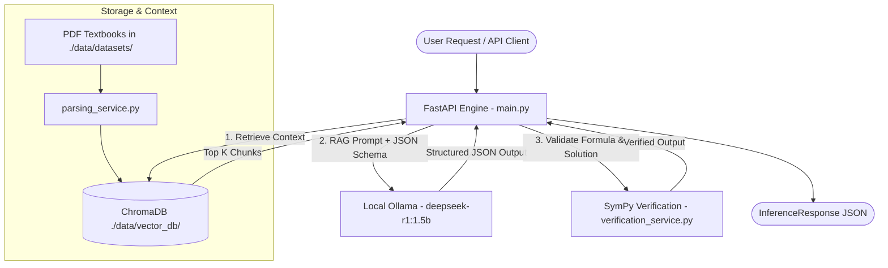

# 🧮 OmniMath-Local

> **"Build a lean, high-performance mathematical reasoning engine optimized for local SSD deployment."**

OmniMath-Local is a self-hosted Mathematical Reasoning and Verification Engine that combines a lightweight local Small Language Model (**`deepseek-r1:1.5b`** via Ollama), vector-based Retrieval-Augmented Generation (RAG via **ChromaDB**), and deterministic symbolic math validation (**SymPy**).

---

## ⚡ Core Features

- 🧠 **Local SLM Reasoning**: Integrates with local Ollama running `deepseek-r1:1.5b` with strict Pydantic JSON schema enforcement (`reasoning_steps`, `core_formula`, `final_answer`).
- 📚 **Textbook-Backed RAG**: Vector index with over **12,000+ indexed chunks** extracted from high-quality mathematics and statistics textbooks using `bge-small-en-v1.5` / `all-MiniLM-L6-v2` embeddings.
- 📐 **SymPy Truth Layer**: Parses LaTeX formulas automatically to perform symbolic differentiation, algebraic simplification, and exact solution verification.
- 💾 **Lean SSD Architecture**: Optimized for a **<10GB disk footprint** on local SSD with automatic storage health-gate checks.
- 🚀 **FastAPI Core**: Asynchronous RESTful service built with FastAPI, complete with dataset management and health check endpoints.

---

## 🏗️ System Architecture



---

## 📂 Project Structure

```text
omnimath-backend/
├── data/                       # Local SSD Storage Root (<10GB)
│   ├── datasets/               # PDF Textbooks (Calculus, Algebra, Data Science, Stats)
│   ├── models/                 # Cached HuggingFace & Transformer models
│   └── vector_db/              # Persistent ChromaDB store (12,000+ vector chunks)
├── main.py                     # FastAPI application entrypoint & routing
├── config.py                   # Storage health gate & environment settings
├── schemas.py                  # Pydantic data schemas for requests/responses
├── inference_service.py        # Asynchronous client for local Ollama SLM
├── verification_service.py     # SymPy symbolic verification & LaTeX parsing
├── vector_service.py           # ChromaDB client & embedding retrieval service
├── parsing_service.py          # PyMuPDF text extractor with sliding window chunking
├── storage_service.py          # Async dataset file handler (.parquet & .json)
├── ingest_pipeline.py          # Dataset ingestion script for math textbooks
├── chat.py                     # CLI interactive chat interface
└── PROGRESS.md                 # Live phase milestone tracking
```

---

## 🚀 Quickstart Guide

### Prerequisites

1. **Python 3.10+** installed.
2. **Ollama** installed and running locally (`http://localhost:11434`).
3. **Pull Target Model**:
   ```bash
   ollama pull deepseek-r1:1.5b
   ```

### 1. Installation

Clone the repository and install required Python packages:

```bash
git clone https://github.com/krutiktikam/omni-math.git
cd omni-math
pip install fastapi uvicorn pydantic pydantic-settings httpx pymupdf chromadb sentence-transformers sympy pandas pyarrow
```

### 2. Configure Environment (`.env`)

Create a `.env` file in the root directory (optional defaults provided in `config.py`):

```env
OMNIMATH_STORAGE_PATH=./data
DEBUG=True
APP_NAME="Omnimath Backend"
OLLAMA_BASE_URL=http://localhost:11434
DEFAULT_MODEL=deepseek-r1:1.5b
```

### 3. Ingest Textbook Datasets into ChromaDB

Place your math PDFs in `./data/datasets/` and run the ingestion pipeline:

```bash
python ingest_pipeline.py
```

### 4. Launch FastAPI Server

Start the API server:

```bash
python main.py
```
Or with Uvicorn reload:
```bash
uvicorn main:app --reload --port 8000
```

---

## 🔌 API Reference

### 1. Mathematical Reasoning Endpoint
`POST /inference/reason`

**Request Body:**
```json
{
  "prompt": "Find the derivative of f(x) = x^3 + 4*x^2 - 5*x + 7 with respect to x.",
  "model": "deepseek-r1:1.5b",
  "step_by_step": false
}
```

**Response:**
```json
{
  "reasoning_steps": "Step 1: Identify the terms that can be differentiated individually.",
  "core_formula": "f'(x) = 3x^2 + 8x - 5",
  "final_answer": "3x^2 + 8x - 5",
  "model_used": "deepseek-r1:1.5b",
  "generation_time": 1.73,
  "verification_details": {
    "verified": true,
    "simplified": "-3*x**2 - 8*x + f'(x) + 5",
    "expanded": "-3*x**2 - 8*x + f'(x) + 5",
    "derivative_wrt_x": "-6*x + Derivative(f'(x), x) - 8",
    "answer_verified": true
  }
}
```

**With step-by-step solution (`step_by_step: true`):**
```json
{
  "reasoning_steps": "Step 1: Identify the terms that can be differentiated individually.",
  "core_formula": "f'(x) = 3x^2 + 8x - 5",
  "final_answer": "3x^2 + 8x - 5",
  "model_used": "deepseek-r1:1.5b",
  "generation_time": 1.73,
  "verification_details": {
    "verified": true,
    "simplified": "-3*x**2 - 8*x + f'(x) + 5",
    "expanded": "-3*x**2 - 8*x + f'(x) + 5",
    "derivative_wrt_x": "-6*x + Derivative(f'(x), x) - 8",
    "answer_verified": true
  },
  "step_by_step_solution": {
    "operation_type": "derivative",
    "steps": [
      {
        "step_number": 1,
        "explanation": "Start with the given function",
        "expression_latex": "f(x) = x^3 + 4x^2 - 5x + 7",
        "expression": "f(x) = x^3 + 4x^2 - 5x + 7"
      },
      {
        "step_number": 2,
        "explanation": "Apply differentiation rules (power rule and sum rule)",
        "expression_latex": "f'(x) = 3x^2 + 8x - 5",
        "expression": "f'(x) = 3x^2 + 8x - 5"
      }
    ],
    "final_result": "3x^2 + 8x - 5",
    "final_result_latex": "3x^2 + 8x - 5"
  }
}
```

### 2. Health & Storage Check Endpoint
`GET /health`

**Response:**
```json
{
  "status": "online",
  "storage": "healthy",
  "storage_path": "C:\\Users\\...\\omnimath-backend\\data",
  "app_name": "Omnimath Backend"
}
```

---

## 📈 System Implementation Roadmap

- [x] **Phase 1**: Infrastructure Setup & SSD Storage Optimization.
- [x] **Phase 2**: Core FastAPI Engine, Ollama Integration & Pydantic JSON Schemas.
- [x] **Phase 3**: Textbook PDF Parsing & ChromaDB Vector RAG (12,000+ chunks indexed).
- [x] **Phase 4**: Step-by-Step Solution Generation & Extended SymPy Verification.
- [ ] **Phase 5**: Langfuse / OpenTelemetry Execution Tracing & Latency Map.
- [ ] **Phase 6**: QLoRA Adapter Training & DPO Calibration Blocks (HuggingFace TRL).

---

## 📜 License
MIT License. Built for local, privacy-focused mathematical research and verification.
