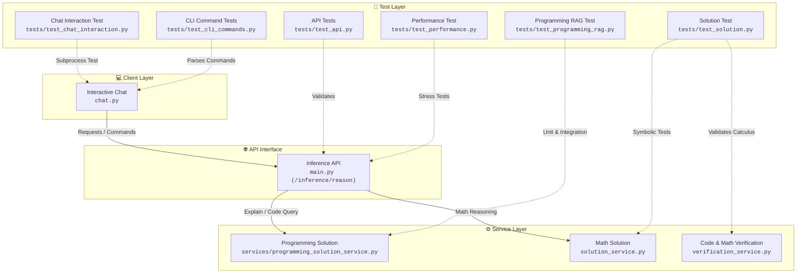
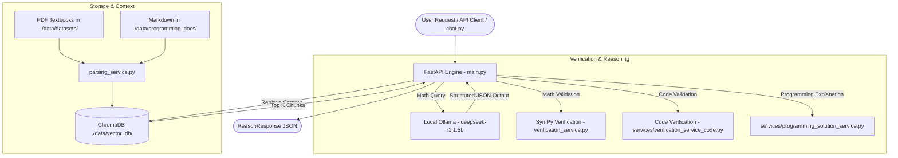

# 🧮 OmniMath-Local

> **"Build a lean, high-performance mathematical reasoning engine optimized for local SSD deployment."**

OmniMath-Local is a self-hosted Mathematical Reasoning and Verification Engine that combines a lightweight local Small Language Model (**`deepseek-r1:1.5b`** via Ollama), vector-based Retrieval-Augmented Generation (RAG via **ChromaDB**), deterministic symbolic math validation (**SymPy**), and an AST-driven programming verification and concept reasoning pipeline.

---

## ⚡ Core Features

- 🧠 **Local SLM Reasoning**: Integrates with local Ollama running `deepseek-r1:1.5b` with strict Pydantic JSON schema enforcement (`reasoning_steps`, `core_formula`, `final_answer`).
- 📚 **Textbook & Code RAG**: Vector index with over **12,000+ indexed chunks** extracted from mathematics/statistics textbooks and programming documentation using `all-MiniLM-L6-v2` embeddings.
- 📐 **SymPy Truth Layer**: Parses LaTeX formulas automatically to perform symbolic differentiation, algebraic simplification, integration, and exact solution verification.
- 💻 **Programming Concepts & Code Verification**: AST parsing with **Tree-Sitter** (Python & JavaScript), static analysis with **Ruff**, and multi-step concept breakdowns.
- 💾 **Lean SSD Architecture**: Optimized for a **<10GB disk footprint** on local SSD with automatic storage health-gate checks.
- 🚀 **FastAPI Core & Dual Routing**: Asynchronous RESTful service built with FastAPI handling both mathematical proofs and programming queries.
- 💬 **Interactive CLI (`chat.py`)**: Terminal chat interface with language switching (`/setlang`), concept explanations (`/explain`), and code examples (`/example`).

---

## 🏗️ System Architecture & Test Mapping

### Layered Architecture & Test Relationships



<details>
<summary>📐 View Experimental Mermaid <code>architecture-beta</code> Specification</summary>

```text
architecture-beta
    group clients(cloud)[Client Layer]
    group core(server)[Service Layer]
    group api(internet)[API Interface]
    group tests(disk)[Test Layer]

    service chat(server)[Interactive Chat] in clients
    service programming(server)[Programming Solution] in core
    service math(server)[Math Solution] in core
    service verification(server)[Code Verification] in core
    service endpoint(internet)[Inference API] in api

    service apitest(server)[API Tests] in tests
    service chatitest(server)[Chat Interaction Test] in tests
    service clitest(server)[CLI Command Tests] in tests
    service performancetest(server)[Performance Test] in tests
    service ragtest(server)[Programming RAG Test] in tests
    service solutiontest(server)[Solution Test] in tests

    chat:R --> L:endpoint
    endpoint{group}:B --> T:programming{group}
    endpoint{group}:R --> L:math{group}

    apitest{group}:R --> L:endpoint{group}
    performancetest{group}:R --> L:endpoint{group}
    chatitest{group}:R --> L:chat{group}
    clitest{group}:T --> B:chat{group}
    ragtest{group}:R --> L:programming{group}
    solutiontest{group}:R --> L:math{group}
    solutiontest{group}:B --> T:verification{group}

    align column apitest performancetest
```
</details>

---

### Data & Ingestion Pipeline Flow



---

## 📂 Project Structure

```text
omnimath_backend/
├── main.py                             # FastAPI application entrypoint & dual routing
├── config.py                           # Storage health gate & environment settings
├── schemas.py                          # Pydantic data schemas for requests/responses
├── inference_service.py                # Asynchronous client for local Ollama SLM
├── verification_service.py             # Unified SymPy math and code verification
├── solution_service.py                 # Step-by-step calculus & algebraic solver
├── vector_service.py                   # ChromaDB client & embedding retrieval service
├── parsing_service.py                  # PyMuPDF and Tree-Sitter unified document extractor
├── storage_service.py                  # Async dataset file handler (.parquet & .json)
├── ingest_pipeline.py                  # Dataset ingestion script for math textbooks
├── ingest_programming_docs.py          # Documentation ingestion script for programming markdown
├── chat.py                             # CLI interactive chat interface
├── GEMINI.md                           # System specification context & guided rules
├── PROGRESS.md                         # Live phase milestone tracking
├── TEST_SUMMARY.md                     # Performance & testing summary report
│
├── services/                           # Modular Domain Services
│   ├── parsing_service_code.py         # Tree-Sitter AST code parsing (Python & JavaScript)
│   ├── verification_service_code.py    # Syntax validation, Ruff linting & sandbox execution
│   └── programming_solution_service.py # Step-by-step programming concept explanations
│
├── tests/                              # Test & Verification Suites
│   ├── test_programming_rag.py         # Core RAG, parser, and verification integration test
│   ├── test_performance.py             # VRAM (<3.5GB) and latency (<3s) stress benchmarks
│   ├── test_solution.py                # Step-by-step calculus & equation solving tests
│   ├── test_cli_commands.py            # Unit tests for chat.py command parsing
│   ├── test_chat_interaction.py        # Subprocess interactive CLI integration test
│   └── test_api.py                     # API endpoint smoke tests
│
└── data/                               # Local SSD Storage Root (<10GB)
    ├── datasets/                       # PDF Textbooks (Calculus, Algebra, Data Science, Stats)
    ├── programming_docs/               # Programming guide documents (.md)
    ├── models/huggingface/             # Cached HuggingFace & Transformer models
    └── vector_db/                      # Persistent ChromaDB store (12,300+ vector chunks)
```

---

## 🚀 Quickstart Guide

### Prerequisites

1. **Python 3.10+** installed.
2. **Ollama** installed and running locally (`http://localhost:11434`).
3. **Pull Target Model**:
   ```bash
   ollama pull deepseek-r1:1.5b
   ```

### 1. Installation

Clone the repository and install required Python packages:

```bash
git clone https://github.com/krutiktikam/omni-math.git
cd omnimath_backend
pip install fastapi uvicorn pydantic pydantic-settings httpx pymupdf chromadb sentence-transformers sympy pandas pyarrow tree-sitter tree-sitter-python tree-sitter-javascript ruff
```

### 2. Configure Environment (`.env`)

Create a `.env` file in the root directory (optional defaults provided in `config.py`):

```env
OMNIMATH_STORAGE_PATH=./data
DEBUG=True
APP_NAME="Omnimath Backend"
OLLAMA_BASE_URL=http://localhost:11434
DEFAULT_MODEL=deepseek-r1:1.5b
```

### 3. Ingest Datasets into ChromaDB

- **Math Textbooks**:
  ```bash
  python ingest_pipeline.py
  ```
- **Programming Documentation**:
  ```bash
  python ingest_programming_docs.py
  ```

### 4. Launch FastAPI Server

Start the API server:

```bash
python main.py
```
Or with Uvicorn reload:
```bash
uvicorn main:app --reload --port 8000
```

### 5. Interactive CLI Chat

Start the interactive terminal client:

```bash
python chat.py
```

Available commands in `chat.py`:
- `/setlang <python|javascript|ts>` - Change active programming language context.
- `/explain <concept>` - Get step-by-step explanation with code samples.
- `/example <task>` - Request verified code generation.
- `/exit` or `/quit` - Exit the CLI.

---

## 🧪 Running Tests

Run the test suites from the project root:

```bash
# 1. Test Programming RAG Pipeline & Services
python tests/test_programming_rag.py

# 2. Test Step-by-Step Calculus & Math Solutions
python tests/test_solution.py

# 3. Test CLI Command Handlers
python tests/test_cli_commands.py

# 4. Performance & VRAM Benchmark (Requires server running on port 8000)
python tests/test_performance.py
```

---

## 🔌 API Reference

### Main Endpoint: `POST /inference/reason`

#### 1. Mathematical Query
**Request Body:**
```json
{
  "prompt": "Find the derivative of f(x) = x^3 + 4*x^2 - 5*x + 7 with respect to x.",
  "step_by_step": true
}
```

**Response:**
```json
{
  "status": "success",
  "type": "math",
  "result": {
    "answer": "Processed math query: Find the derivative of f(x) = x^3 + 4*x^2 - 5*x + 7 with respect to x.",
    "steps": ["Step 1: Parse", "Step 2: Solve"]
  }
}
```

#### 2. Programming Explanation Query
**Request Body:**
```json
{
  "prompt": "Explain Python decorators",
  "step_by_step": true,
  "include_programming": true
}
```

**Response:**
```json
{
  "status": "success",
  "type": "programming_explanation",
  "result": {
    "concept": "Explain Python decorators",
    "language": "python",
    "steps": [
      {
        "step_number": 1,
        "explanation": "A decorator is a function that takes another function and extends its behavior without modifying it.",
        "code_example": {
          "language": "python",
          "code": "def my_decorator(func):\n    def wrapper():\n        print('Before function')\n        func()\n        print('After function')\n    return wrapper",
          "explanation": "The decorator wraps the original function with new behavior."
        }
      }
    ],
    "related_concepts": ["python basics", "python best practices"],
    "complexity_analysis": {
      "time": "O(1)",
      "space": "O(1)"
    }
  }
}
```

#### 3. Code Generation & Verification Query
**Request Body:**
```json
{
  "prompt": "Write a Python function to add two numbers",
  "include_programming": true
}
```

**Response:**
```json
{
  "status": "success",
  "type": "programming_code",
  "result": {
    "code": "def add(a, b):\n    return a + b",
    "explanation": "Generated code snippet."
  },
  "verification": {
    "syntax_check": {
      "valid": true,
      "error": null,
      "node_count": 8
    },
    "static_analysis": {
      "tool": "ruff",
      "issue_count": 0,
      "issues": []
    },
    "overall_verified": true
  }
}
```

---

## 📈 System Implementation Roadmap

- [x] **Phase 1**: Infrastructure Setup & SSD Storage Optimization.
- [x] **Phase 2**: Core FastAPI Engine, Ollama Integration & Pydantic JSON Schemas.
- [x] **Phase 3**: Textbook PDF Parsing & ChromaDB Vector RAG (12,000+ chunks indexed).
- [x] **Phase 4**: Step-by-Step Solution Generation & Extended SymPy Verification.
- [x] **Phase 5**: Programming Concepts RAG, Tree-Sitter & Ruff Verification.
- [x] **Phase 6**: CLI Enhancement with Programming Commands (`/setlang`, `/explain`, `/example`).
- [ ] **Phase 7**: Knowledge Base Expansion & Hybrid Search Mechanics.
- [ ] **Phase 8**: Local Langfuse / OpenTelemetry Tracing Layers.
- [ ] **Phase 9**: TRL Fine-Tuning Pipeline (QLoRA & DPO Calibration Blocks).

---

## 📜 License
MIT License. Built for local, privacy-focused mathematical and programming research and verification.