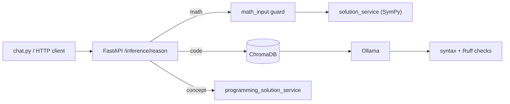

# OmniMath-Local

Local-first backend and CLI for math and programming questions. FastAPI API, a
Pydantic-validated response model, Ollama (deepseek-r1:1.5b, Q4_K_M) for model
calls, ChromaDB retrieval (all-MiniLM-L6-v2), SymPy for math, and syntax/lint
checks for code. Developed on an RTX 3050 (4 GB), Windows.

> **Status: work in progress.** No accuracy, latency or memory figures are
> published yet. They will be added to `docs/results.md` once an evaluation
> harness produces them.

## What works today
- **Derivatives and polynomial equations in one unknown** are computed with
  SymPy. Equation roots are checked by substitution. Responses carry
  `status: computed` and `llm_used: false`.
- **Input guard:** ambiguous or non-math input is refused with a reason
  instead of being guessed (see `math_input.py`, `tests/test_math_input.py`).
- **Programming questions:** retrieval over a local ChromaDB index, code
  generation via Ollama, and Python syntax (`ast`) plus Ruff lint checks.
- **CLI** (`chat.py`): `/setlang`, `/explain`, `/example`, free-form math.

## Current limitations
- The language model is **not** used on the math route yet.
- `/explain` for common concepts returns curated text, not model output.
  Related-concept and complexity fields were removed or are unverified.
- Code checks cover syntax and lint only. They do not prove the code is correct.
- Generated code can time out and fall back to retrieved text.
- Only `tests/test_math_input.py` contains assertions that can fail. The rest of
  the suite is being rebuilt.
- No pinned requirements file, no CI and no Docker image yet.
- The API currently binds to all interfaces. Run it only on a trusted network.

## Run (development)
    ollama pull deepseek-r1:1.5b
    python main.py      # API on port 8000
    python chat.py      # CLI

## Architecture

## Data and licences
Textbook text and the vector index are **not** distributed with this repository.
They are built locally from the original downloads.
- Calculus Volume 1, Algebra and Trigonometry 2e, Introductory Statistics 2e:
  OpenStax, Rice University, CC BY 4.0.
  - Calculus Volume 1 Authors: Edwin “Jed” Herman, Gilbert Strang. Source: https://openstax.org/details/books/calculus-volume-1
  - Algebra and Trigonometry 2e Author: Jay Abramson. Source: https://openstax.org/details/books/algebra-and-trigonometry-2e
  - Introductory Statistics 2e Authors: Barbara Illowsky, Susan Dean. Source: https://openstax.org/details/books/introductory-statistics-2e
- Principles of Data Science: OpenStax, Rice University, CC BY-NC-SA 4.0.
  Authors: Dr. Shaun V. Ault, Dr. Soohyun Nam Liao, Larry Musolino. Source: https://openstax.org/details/books/principles-data-science. Non-commercial use only.
- Code and task examples: TheAlgorithms/Python (MIT), faif/python-patterns (MIT), and Code Alpaca (Apache-2.0).
- Embedding model all-MiniLM-L6-v2: Apache-2.0 (sentence-transformers/all-MiniLM-L6-v2).
- deepseek-r1: MIT (as reported by `ollama show`).
