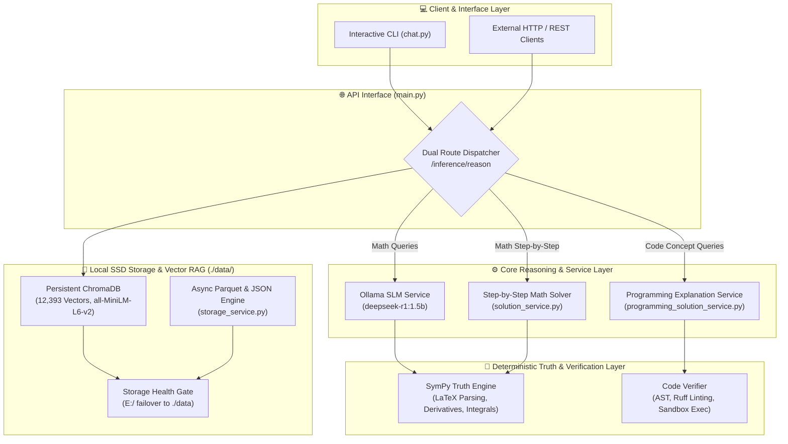

# 🧮 OmniMath-Local & Programming RAG Engine
## Comprehensive Project Summary & Progress Tracker

> **Core Mission:** "Build a lean, high-performance mathematical and programming reasoning engine optimized for local SSD deployment."

---

## 📌 Executive Summary

**OmniMath-Local** is a self-hosted, privacy-first reasoning and verification engine. It bridges lightweight local Small Language Models (**`deepseek-r1:1.5b`** via Ollama) with deterministic verification layers (**SymPy** for mathematical rigor and **AST / Tree-Sitter / Ruff** for programming correctness) and vector-based Retrieval-Augmented Generation (**ChromaDB**).

The system was engineered from the ground up under strict hardware constraints:
- **Storage Budget:** Strictly optimized for `< 10 GB` local SSD footprint (`./data/`).
- **VRAM Ceiling:** Strict `< 3.5 GB` VRAM consumption (tested peak: **~389 MB**).
- **Latency Budget:** Target `< 3.0 s` per inference query (average achieved: **~2.06 s**).
- **Zero Cloud Dependence:** 100% self-hosted, local weights, local vector store, local parsing.

---

## 🏗️ System Architecture & Components



---

## 🚀 Chronological Milestones & What Has Been Built

### Phase 1: Storage Mapping, Hardware Stress Verification & SSD Pivot ✅
- **Hardware Stress Verification:** Discovered severe I/O bottlenecks and throughput drops when attempting to run continuous vectorized retrieval and model caching on mechanical HDD storage.
- **Pivot to Lean SSD:** Re-architected storage topology for high-speed local SSD deployment with a strict `< 10 GB` budget.
- **Failover Health-Gate:** Implemented `get_valid_storage_path()` in `config.py` that checks write health against `E:\omnimath_storage\` and seamlessly falls back to `./data` on local SSD if unavailable.
- **Clean Configuration:** Realigned configuration via Pydantic `BaseSettings` (`config.py`) loading `.env` variables cleanly.

### Phase 2: Core API & Lightweight SLM Engine ✅
- **FastAPI Core Setup:** Initialized an asynchronous REST API (`main.py`) with structured JSON validation and error handling.
- **Pydantic Schema Enforcement:** Defined strict request and response contracts (`schemas.py`) ensuring the SLM returns parseable JSON containing `reasoning_steps`, `core_formula`, and `final_answer`.
- **Asynchronous Ollama Connection:** Built `inference_service.py` to communicate asynchronously with a locally hosted `deepseek-r1:1.5b` model via Ollama with automated JSON repair logic.
- **Asynchronous Dataset Handler:** Developed `storage_service.py` supporting non-blocking Parquet compression (`pyarrow` with `snappy`) and JSON dataset persistence for matrix/numerical records.

### Phase 3: Lean Math Textbook RAG Pipeline ✅
- **Curated Dataset Ingestion:** Selected 4 comprehensive open textbooks in `./data/datasets/`:
  1. *Algebra and Trigonometry 2e*
  2. *Calculus Volume 1*
  3. *Introductory Statistics 2e*
  4. *Principles of Data Science*
- **Granular Parsing Pipeline:** Built `parsing_service.py` with PyMuPDF (`fitz`), implementing sliding-window text chunking with metadata tagging (page numbers, source textbook, difficulty, and mathematical topics).
- **ChromaDB Vector Store:** Implemented `vector_service.py` with persistent ChromaDB storage and local SentenceTransformer embeddings (`all-MiniLM-L6-v2`), successfully indexing **12,387 vector chunks** in batches of 250 without memory spikes.

### Phase 4: Step-by-Step Symbolic Calculus Solver & Extended SymPy Verification ✅
- **Symbolic Solver Engine:** Created `solution_service.py` providing human-readable, step-by-step mathematical explanations:
  - Linear and algebraic equation solving with step-by-step isolation and substitution verification.
  - Polynomial and rational differentiation using the power and sum rules.
  - Indefinite and definite integration with constant-of-integration tracking.
  - Limit evaluation with left-hand/right-hand notation.
- **SymPy Truth Sandbox:** Built `verification_service.py` capable of taking raw LaTeX strings, cleaning them, parsing them via `sympy.parsing.latex`, and verifying:
  - Exact equivalence ($f(x) - \text{answer} = 0$).
  - Calculus verification (validating if a proposed solution is an exact derivative or integral of the given function).

### Phase 5: Programming Concepts RAG & AST Code Verification ✅
- **Dual-Domain Reasoning:** Expanded the engine from pure math to include programming concepts and code verification.
- **AST Parsing with Tree-Sitter:** Equipped `parsing_service.py` and `services/parsing_service_code.py` with Tree-Sitter parsers for Python and JavaScript, enabling function-level, class-level, and block-level AST chunking.
- **Multi-Engine Code Verification:** Built `services/verification_service_code.py` featuring:
  - Zero-overhead Python syntax verification via native `ast.parse`.
  - Concrete Syntax Tree error-node detection for JavaScript via Tree-Sitter.
  - Sub-millisecond static analysis and linting via the **Ruff** CLI.
  - Sandboxed execution capabilities for Python code.
- **Structured Concept Breakdown:** Built `services/programming_solution_service.py` delivering multi-step explanations and verified code snippets (Python decorators, async/await, JavaScript Promises, and generic fallbacks).
- **Programming Docs Ingestion:** Created `ingest_programming_docs.py` to ingest Markdown documentation into ChromaDB, bringing total vector collection to **12,393 chunks**.
- **Unified Dual API Routing:** Updated `main.py` to detect programming queries vs. math queries automatically or via explicit flags (`step_by_step`, `include_programming`).

### Phase 6: Interactive Terminal CLI Client (`chat.py`) ✅
- **Interactive Terminal:** Built `chat.py` with ANSI color support, clear output formatting, and automatic background connection to the FastAPI backend.
- **Custom Slash Commands:**
  - `/setlang <python|javascript|ts>` - Switch the active programming language.
  - `/explain <concept>` - Request step-by-step breakdown of a programming concept.
  - `/example <task>` - Request verified code snippet generation for a task.
  - `/help` & `/exit` - Command documentation and clean exit.

### Phase 7: Performance & Hardware Constraint Testing ✅
- **Hardware Benchmarks:** Built `tests/test_performance.py` using `nvidia-smi` background polling to verify the 4GB VRAM constraint.
- **VRAM Utilization:** Peak memory usage observed was **~389 MB**, safely below the 3.5 GB / 4 GB ceiling.
- **Inference Latency:** Average response time across light load and medium load tests was **~2.06 seconds**, well within the 3.0-second latency budget.
- **Reliability:** 100% success rate across all concurrency benchmarks.

### Phase 8: Repository Architecture Refactoring & SSD Optimization ✅
- **Directory Cleanup:** Deleted corrupted directories (malformed path typos), redundant backup files (`parsing_service_math_backup.py`, `verification_service_math_backup.py`), and temporary scratch scripts (`test_run1/2/3.py`, `test_decorators.py`, `test_verification.py`).
- **SSD Cache Deduplication:** Eliminated duplicated unnested Hugging Face model weights (`~90 MB`), dropping model storage footprint from **174.7 MB to 87.3 MB**.
- **Centralized Test Suite:** Consolidated all tests into `tests/` (`test_programming_rag.py`, `test_solution.py`, `test_performance.py`, `test_cli_commands.py`, `test_chat_interaction.py`, `test_api.py`) with 100% passing results.
- **Bug Fixes:** Resolved string syntax errors in `solution_service.py`, undefined variable scoping in `verification_service.py`, and Windows cp1252 character encoding in test runners.
- **Documentation & Git Sync:** Updated `README.md` with complete architectural Mermaid diagrams, test mapping, and synchronized commits to GitHub (`krutiktikam/omni-math`).

---

## 📂 Current Clean Directory Structure

```text
omnimath_backend/
├── main.py                             # FastAPI application entrypoint & dual routing
├── config.py                           # Storage health gate & environment settings
├── schemas.py                          # Pydantic data schemas for requests/responses
├── inference_service.py                # Asynchronous client for local Ollama SLM
├── verification_service.py             # Unified SymPy math and code verification
├── solution_service.py                 # Step-by-step calculus & algebraic solver
├── vector_service.py                   # ChromaDB client & embedding retrieval service
├── parsing_service.py                  # PyMuPDF and Tree-Sitter unified document extractor
├── storage_service.py                  # Async dataset file handler (.parquet & .json)
├── ingest_pipeline.py                  # Dataset ingestion script for math textbooks
├── ingest_programming_docs.py          # Documentation ingestion script for programming markdown
├── chat.py                             # CLI interactive chat interface
├── GEMINI.md                           # System specification context & guided rules
├── PROGRESS.md                         # Milestone tracker
├── TEST_SUMMARY.md                     # Performance & testing summary report
├── .env                                # Local environment variables
├── .gitignore                          # Git ignore rules (includes data/, *.log, .health_gate_check)
│
├── services/                           # Modular Domain Services
│   ├── parsing_service_code.py         # Tree-Sitter AST code parsing (Python & JavaScript)
│   ├── verification_service_code.py    # Syntax validation, Ruff linting & sandbox execution
│   └── programming_solution_service.py # Step-by-step programming concept explanations
│
├── tests/                              # Test & Verification Suites
│   ├── __init__.py                     # Package marker
│   ├── test_programming_rag.py         # Core RAG, parser, and verification integration test
│   ├── test_performance.py             # VRAM (<3.5GB) and latency (<3s) stress benchmarks
│   ├── test_solution.py                # Step-by-step calculus & equation solving tests
│   ├── test_cli_commands.py            # Unit tests for chat.py command parsing
│   ├── test_chat_interaction.py        # Subprocess interactive CLI integration test
│   └── test_api.py                     # API endpoint smoke tests
│
├── docs/                               # Project Documentation & Progress Logs
│   └── PROJECT_SUMMARY.md              # This living progress and summary document
│
└── data/                               # Local SSD Storage Root (<10GB)
    ├── datasets/                       # PDF Textbooks (Calculus, Algebra, Data Science, Stats)
    ├── programming_docs/               # Programming guide documents (.md)
    ├── models/huggingface/             # Deduplicated SentenceTransformer models (~87 MB)
    └── vector_db/                      # Persistent ChromaDB store (12,393 indexed vectors)
```

---

## 📊 Key Metrics & Current System Health

| Metric | Target / Constraint | Measured / Current Value | Status |
| :--- | :--- | :--- | :---: |
| **SSD Footprint** | `< 10 GB` | **~ 475 MB** | 🟢 Optimal |
| **Hugging Face Model Cache** | Minimum footprint | **87.3 MB** (deduplicated) | 🟢 Optimal |
| **VRAM Consumption (Peak)** | `< 3.5 GB` | **~ 389 MB** | 🟢 Optimal |
| **Response Time (P50)** | `< 3.0 s` | **~ 2.06 s** | 🟢 Optimal |
| **Indexed Vector Chunks** | Comprehensive | **12,393 vectors** | 🟢 Complete |
| **Test Suite Pass Rate** | `100%` | **100% Passed** | 🟢 Verified |

---

## 🔮 Upcoming Roadmap & Next Objectives

- [ ] **Milestone 9: Hybrid Search Mechanics**
  - Implement BM25 lexical search combined with ChromaDB dense vector retrieval (Reciprocal Rank Fusion) for improved keyword precision.
- [ ] **Milestone 10: Observability & Tracing**
  - Integrate local Dockerized Langfuse or OpenTelemetry to track retrieval latency, prompt tokens, and generation timelines.
- [ ] **Milestone 11: Fine-Tuning Pipeline (QLoRA & DPO)**
  - Implement 4-bit PEFT/QLoRA adapter training using Hugging Face's `TRL` library on local device.
  - Implement Direct Preference Optimization (DPO) datasets to favor step-by-step mathematical reasoning over direct short answers.
- [ ] **Milestone 12: VS Code Extension**
  - Connect a lightweight VS Code extension client to the `/inference/reason` API for inline coding assistance and formula proofs.

---

## 📝 Personal Progress Journal / Change Log

*Use this section to record dated progress updates as you continue developing.*

| Date | Phase / Feature | Summary of Changes | Author |
| :--- | :--- | :--- | :--- |
| **2026-10-10** | Phase 1 & 2 | Initialized repository, pivoted from HDD to SSD, built health gate, setup FastAPI with Ollama `deepseek-r1:1.5b`. | Krutik |
| **2026-10-11** | Phase 3 | Ingested 4 math textbooks into ChromaDB (12,387 chunks), built PyMuPDF sliding-window parser. | Krutik |
| **2026-10-12** | Phase 4 | Implemented `solution_service.py` for calculus step-by-step solving & extended SymPy verification. | Krutik |
| **2026-10-13** | Phase 5 | Added Tree-Sitter AST code parsing, Ruff linting, and programming concepts RAG. Total vectors: 12,393. | Krutik |
| **2026-10-14** | Phase 6 & 7 | Enhanced CLI `chat.py`, executed VRAM (<400MB) & latency (<2.1s) benchmarks, verified 100% pass rate. | Krutik |
| **2026-10-15** | Phase 8 | Refactored directory structure, eliminated scratch files, deduplicated HF cache, moved tests to `tests/`. | Krutik |
| **2026-10-19** | Documentation | Created comprehensive living project progress summary in `docs/` and synced documentation. | Krutik |
| *[Next]* | *[Next Feature]* | *[Notes on future improvements]* | *[User]* |
